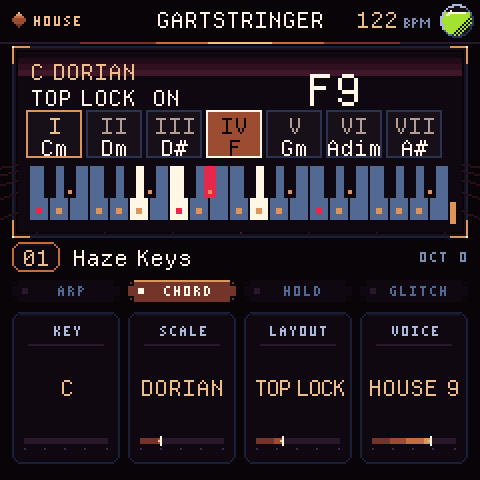
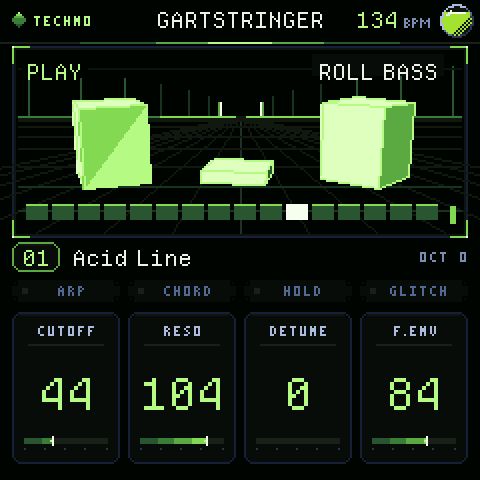
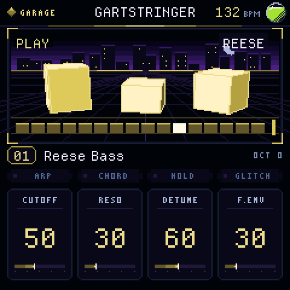
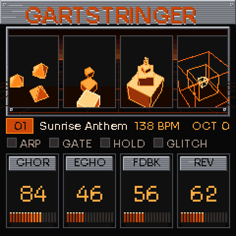
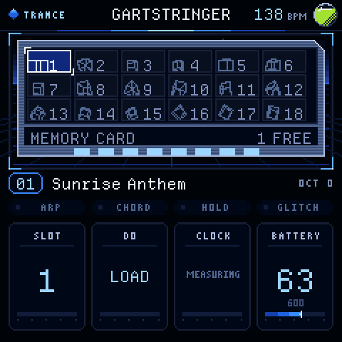
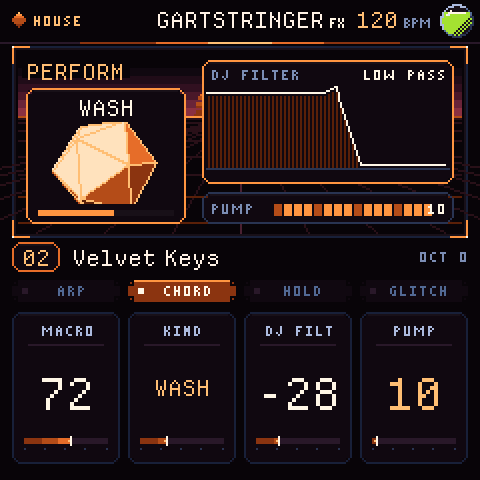
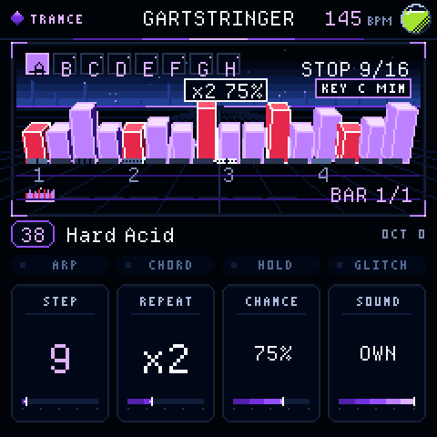

# GartStringer

A synthesizer firmware for the M-VAVE FM-1 (JieLi AC791N) in four worlds you step between: TRANCE (supersaw leads from euphoric to haunting, rolling bass, a gate, a glitch engine), HOUSE (hazy FM keys, organs, donk bass, one-key chords, a sidechain-style pump), TECHNO (acid lines, metal, drones, noise) and GARAGE (reese and organ basses, bell stabs, the shuffle). No drums: it is made to sit beside your drum machine and to keep time with it, on its own clock or following MIDI clock. The screen is a small 3D world in pixels, with a scene and colours for each world.

        

## What it does
- **Four worlds:** 40 TRANCE patches, then 24 each of HOUSE, TECHNO and GARAGE. PRESETS runs through all of them; ALGORITHM on the home page steps to the next world (to the patch you last used there). The world sets the look; the sequencer and the save slots are shared.
- **Oscillators:** supersaw (seven detuned saws), hyper sync, PWM stack, roll bass, feedback, FM keys, drawbar organ, donk (an FM bass), metal (inharmonic FM), noise, reese, plus a sub. Six voices.
- **Filter:** state-variable, LP12 / LP24 / band / high / vowel. Two ADSR envelopes, one LFO (pitch, filter, amp, colour, detune), glide, poly / mono / legato, hold.
- **Step sequencer:** up to 128 steps in eight patterns (A–H). Press SEQ, then REC: a one-bar count-in with the metronome, and then you play and the notes drop onto the line you can see running. PLAY runs and stops it. ALGORITHM switches pattern (it waits for the end of the pass), and every knob and parameter stays live while it plays. SAVE keeps eighteen slots, each with all eight patterns and every sound setting. With the chords on, each step is a root and plays its chord, in whatever voicing, scale and key the chord page has now. No drums, only notes and a click.
- **Chord instrument:** HOME again opens CHORDS, which shows the key and scale (sixteen scales), the chord you are playing and a three-octave piano with the scale marked. ALGORITHM turns it on and off; K1 key, K2 scale, K3 layout, K4 voicing (close, open, with a bass note, and the house voicings HOUSE 7, HOUSE 9, SHELL and PLANE M9). In the *Top* layouts the white keys are the scale's degrees and the black keys pick the chord type (none = the diatonic chord for that degree); *Side* layouts put the chord buttons on the lowest keys; the *Lock* ones latch them. Chords play through the arp, hold and sequencer, and always use all voices.
- **Gate and pump:** 16 steps, 14 gate patterns (one random), rate and smoothing; and two pumps (1/4, 1/8) that duck the sound on the beat and let it swell back, like a compressor keyed by a kick.
- **Clock:** every length is kept to 1/256 of a sample and no step drops what ran over it, and the sample rate is measured against the 24 MHz crystal and corrected, so the tempo holds beside other hardware (`tools/host/gs_clock_test.c` checks ten minutes at several tempos).
- **MIDI clock:** send clock to the MIDI IN jack or over USB and every clock here follows it (24 ticks a beat; Start, Continue and Stop run the sequencer); the top bar shows EXT and the tempo it measures. Half a second without a tick and the instrument is on its own clock again.
- **Reverb:** four diffusers into an eight-line feedback network; the lows are kept out of the loop and four lines sway, so the tail is a wash with no pitch of its own.
- **Arpeggiator:** 8 patterns, rates, octaves, gate length.
- **Effects:** drive, bit crush, tape (wow, flutter and a darker top), ensemble chorus, glitch (stutter, reverse, tape stop, drop-out; hold REC to fire by hand), tempo-synced ping-pong echo, reverb, soft-limited master.
- **Steps with repeats and chance:** SEQ again opens STEP: K2 makes a step sound two, three or four times in its own time (a ratchet), K3 lets it sound always or 75 / 50 / 25 % of the time, K4 lets the pattern keep a sound of its own, so that A can be a bass and B the chords. Changing patch keeps the notes you have written.
- **Performance page:** HOME, HOME again: one MACRO knob (BUILD, WASH, DARK or CRUSH), a DJ filter (left low-pass, right high-pass, the middle open) and the pump's depth. ALGORITHM switches pattern there. None of it changes the patch.
- **112 factory patches** (40 trance, 24 each of house, techno and garage) and 18 save slots. A slot keeps the sound, the tempo, all eight patterns with their repeats and chances, and the patterns' own sounds. Slots saved by any earlier version are read as they are and never rewritten.

## Controls
K1–K4: the page's four parameters. ALGORITHM: the page's other parameters. PRESETS: patch. SELECT: tempo. EDIT / SCL / ENV / LFO / FX / ARP / SEQ / GLO: oscillator, filter, envelopes, LFO, effects, arp, sequencer and glitch pages (SEQ again: its setup; GLO again: the gate and the pump). PLAY: hold, or run / stop on the sequencer pages (SEQ again: setup, again: bar tools). On the editing pages OCT± jumps a bar. REC held: glitch. OCT±: octave. SAVE: slots. The 27 keys play from C3.

## Build
**Updating.** From 0.5 the running instrument has USB-MIDI and answers the installer page, which updates it in one click. 0.4.0 and earlier have no USB in the instrument: their update mode (OCT− at power-on, or OCT−+OCT++HOME for five seconds) is the chip's own boot loader (a USB disk `WL82 UBOOT1.00`), written with the community tool MvaveFM1Unbricker from Windows or Linux.

`sh build.sh` (device image, needs the JieLi toolchain: `tools/get_toolchain.sh`), `sh tools/build_web.sh` (browser version), `sh tools/make_site.sh OUT` (site). Pushing a `v*` tag builds a release (`release.yml`); `pages.yml` publishes the site and installer.

## Licence
GPL-3.0-only. The FM-1 platform layer builds on Felucca (see `LICENSING.md`). All sound design and code here are original. Not affiliated with M-VAVE.
