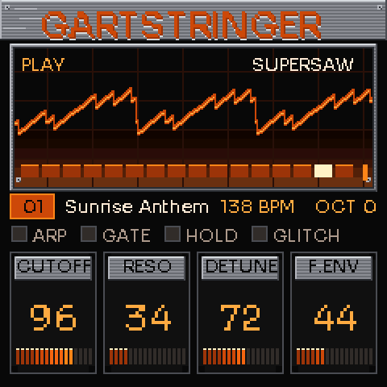
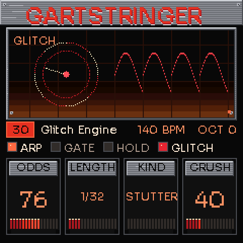

# GartStringer

A supersaw trance synthesizer firmware for the M-VAVE FM-1 (JieLi AC791N). Leads that go from euphoric to haunting, rolling trance bass, a gate, an arpeggiator and a glitch engine, with an orange, brushed-silver and black '90s rave look. **There is no percussion at all**: it is built to play beside your own drums.

 

## What it does
- **Oscillators:** supersaw (seven detuned saws), hyper sync, PWM stack, roll bass, feedback, plus a sub. Six voices.
- **Filter:** state-variable, LP12 / LP24 / band / high / vowel. Two ADSR envelopes, one LFO (pitch, filter, amp, colour, detune), glide, poly / mono / legato, hold.
- **Trance gate:** 16 steps, 14 patterns, random patterns, rate and smoothing.
- **Arpeggiator:** 8 patterns, rates, octaves, gate length.
- **Effects:** drive, bit crush, ensemble chorus, glitch (stutter, reverse, tape stop, drop-out; hold REC to fire by hand), tempo-synced ping-pong echo, reverb, soft-limited master.
- **32 factory patches** and 8 save slots.

## Controls
K1–K4: the page's four parameters. ALGORITHM: the page's other parameters. PRESETS: patch. SELECT: tempo. EDIT / SCL / ENV / LFO / FX / ARP / SEQ / GLO: oscillator, filter, envelopes, LFO, effects, arp, gate and glitch pages. PLAY: hold. REC held: glitch. OCT±: octave. SAVE: slots. The 27 keys play from C3.

## Build
`sh build.sh` (device image, needs the JieLi toolchain: `tools/get_toolchain.sh`), `sh tools/build_web.sh` (browser version), `sh tools/make_site.sh OUT` (site). Pushing a `v*` tag builds a release (`release.yml`); `pages.yml` publishes the site and installer.

## Licence
GPL-3.0-only. The FM-1 platform layer builds on Felucca (see `LICENSING.md`). All sound design and code here are original. Not affiliated with M-VAVE.
